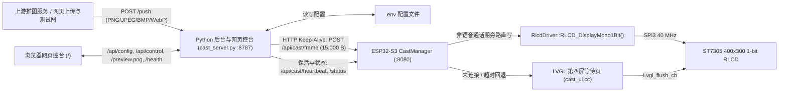

# Waveshare ESP32-S3-RLCD-4.2 无线投屏与网页端控台设计文档

## 1. 背景与硬件基线

本文档描述 `xiaozhi-esp32`（`waveshare-s3-rlcd-4.2` 板型）在现有三屏（天气主页、音乐页、番茄钟页）基础上新增第四屏无线投屏功能，以及配套 Python 后台推图与网页端控台的软件设计。

- **主控芯片**：ESP32-S3-WROOM-1-N16R8（双核 240 MHz，16 MB Flash，8 MB OPI PSRAM）
- **显示屏驱动**：ST7305 反射式液晶，横屏分辨率 `400×300`，SPI3 接口 `40 MHz`
- **当前驱动模式**：`rlcd_driver.cc` 发送 `0x3A=0x11` 与 `0xB9=0x20`，工作在 **1-bit 单色（2 级黑白）**模式，单帧显存固定 `15,000` 字节（`400 × 300 / 8`）
- **资源余量基线**：`ota_0` 应用分区剩余约 `426 KB`，静态 D/IRAM 剩余约 `175 KB`，板载 `8 MB` PSRAM；新增 `esp_http_server`、`cast_ui.cc` 与 `CastManager` 后预计占用约 `40–70 KB` Flash 与 30 KB PSRAM 帧缓冲，满足资源约束
- **IPv4 与网络接口**：复用现有 `WifiManager::GetInstance().GetIpAddress()`、`IsConnected()` 与 `IsConfigMode()`

## 2. 总体架构与数据流

系统分为上游业务推图端、PC/局域网后台控台服务与 ESP32-S3 设备端三部分，通过 HTTP/1.1 长连接传输紧凑的 `15,000` 字节 1-bit 位图帧。

## 3. 灰度转换与最高刷新率分析

### 3.1 灰度级数与软件抖动

ST7305 在本板默认驱动参数下支持 1-bit（2 级：黑/白）像素输出。为兼顾照片灰阶与界面文字清晰度，后台将上游图像统一转为 8-bit 灰度图（`L` 模式），按 `.env` 中 `DITHER_MODE` 参数切换 4 种转换算法并打包为行优先 MSB-first 位图（`1` 表示白色，`0` 表示黑色）：

| `DITHER_MODE` 值 | 算法原理 | 适用场景 | 特点与限制 |
| :--- | :--- | :--- | :--- |
| `floyd` | Floyd-Steinberg 误差扩散（Pillow 原生 C 实现） | 通用图文、网页截图、照片 | 细节还原均衡，单帧转换耗时低于 `5 ms` |
| `atkinson` | Atkinson 误差扩散（仅扩散 6/8 误差） | 仪表盘、插画、强对比图形 | 高光与暗部更干净，减少黑白颗粒噪点 |
| `bayer` | 4×4 有序 Bayer 矩阵阈值抖动 | 高频动态画面、动画监控 | 同灰度值像素位置固定，帧间无随机闪烁 |
| `threshold` | 按 `THRESHOLD`（0–255）硬二值化 | 纯文字、二维码、线条图表 | 边缘绝对锐利，适合无反锯齿图形 |

### 3.2 最高刷新率四层定量估算

以下估算基于板级源码与传输链路计算，最终实际指标以真机联调为准：

1. **SPI3 总线传输层（`rlcd_driver.cc`）**：`pclk_hz = 40 MHz`，单帧 `15,000` 字节（`120,000` bit）纯像素传输耗时约 `3.0 ms`；加上 `RLCD_Display()` 的 `0x2A`/`0x2B`/`0x2C` 窗口指令与 DMA 开销，理论单帧总线耗时约 `3.5–4 ms`（总线理论极限高于 `200 FPS`）。
2. **ST7305 面板与液晶光学响应**：初始化序列开启 High Power Mode（指令 `0x38`，`0xB2=0x02`）。反射式液晶存在物理响应时间，刷新高于 `15–20 FPS` 时易产生拖影或对比度下降，清晰可用上限约为 **10–15 FPS**。
3. **渲染路径差异**：
   - 经 LVGL 重绘（`custom_lcd_display.cc` 默认 `timer_period_ms = 50`，`240 KB` RGB565 帧缓冲与 12 万像素阈值映射）：上限约 `5–10 FPS`。
   - **1-bit 直写路径**：后台传输打包好的 `15,000` 字节位图，设备端仅做 LUT 查表填充 `DispBuffer` 并直接触发 `RLCD_Display()`（投屏激活期在 `Lvgl_flush_cb` 旁路 LVGL 刷新），单帧 CPU 映射约 `2–3 ms`。
4. **Wi-Fi HTTP 收发层**：单帧仅 `14.6 KB`。短连接每次重建 TCP 握手时约 `5–12 FPS`；后台推送线程复用 **HTTP Keep-Alive** 长连接时，局域网单帧收发与刷屏总周期约 `50–80 ms`，整机实际可用上限约为 **10–15 FPS**。

**建议参数**：静态信息看板配置 `PUSH_INTERVAL_MS=500~5000`（`0.2–2 FPS`）；需要动态演示时配置 `PUSH_INTERVAL_MS=100~200`（`5–10 FPS`）。

## 4. 通信协议与 API 规范

### 4.1 帧数据格式约定

- 请求体固定为 `400 × 300 / 8 = 15,000` 字节原始二进制流（`Content-Type: application/octet-stream`）。
- 像素按行优先顺序从左上角 `(0, 0)` 到右下角 `(399, 299)` 排列；每 8 个连续水平像素占 1 字节，高比特（`0x80`）对应左侧第一个像素；`bit = 1` 表示白色（`ColorWhite`），`bit = 0` 表示黑色（`ColorBlack`）。

### 4.2 设备端 HTTP API（端口 `8080`）

若板级配置 `secret_config.h` 中定义了非空 `CAST_AUTH_TOKEN`，所有变更接口校验请求头 `X-Cast-Token`；未定义或为空时不校验。

| 方法与路径 | 说明 | 请求头 / 请求体 | 响应示例 |
| :--- | :--- | :--- | :--- |
| `POST /api/cast/frame` | 接收并刷新单帧画面 | 体：严格 `15,000` 字节 可选头：`X-Cast-Token`、`X-Auto-Switch`（`1`/`0`）、`X-Cast-Timeout`（秒，整数） | `200` `{"ok":true,"frames":12,"blitted":true}`；长度不符返回 `400`；鉴权失败返回 `401` |
| `POST /api/cast/heartbeat` | 保活心跳（启用去重时不重发画面但维持连接） | 可选头：`X-Cast-Token`、`X-Cast-Timeout` | `200` `{"ok":true,"streaming":true}` |
| `POST /api/cast/disconnect` | 主动结束投屏并返回等待页 | 可选头：`X-Cast-Token` | `200` `{"ok":true,"streaming":false}` |
| `GET /api/cast/status` | 查询设备投屏与硬件状态 | 无 | `{"running":true,"streaming":true,"audio_paused":false,"width":400,"height":300,"bpp":1,"mode":"cast","ip":"192.168.1.100","port":8080,"frames":42,"fps":1.0,"battery":85,"rssi":-52}` |

### 4.3 后台控台 HTTP API（默认端口 `8787`）

| 方法与路径 | 说明 | 输入格式 | 返回说明 |
| :--- | :--- | :--- | :--- |
| `GET /` | 网页端控台页面 | 无 | HTML 页面（配套 `/app.css`、`/app.js`） |
| `POST /push` | 上游服务推送原图 | 支持 raw 二进制（PNG/JPEG/BMP/WebP）或 `multipart/form-data`（字段 `image` 或 `file`）；支持可选查询参数 `?push_now=1` 立即触发下发 | `{"ok":true,"width":400,"height":300,"frame_bytes":15000,"sha256":"..."}`；非法图片返回 `400` |
| `GET /api/config` | 获取当前 `.env` 运行配置 | 无 | 配置 JSON |
| `POST /api/config` | 校验更新并写入 `.env` | JSON 配置对象；支持即时按新抖动/适配参数重算缓存帧与预览图 | 更新后配置 JSON；校验失败返回 `400` 与字段明细 |
| `POST /api/control` | 控台即时操作 | JSON `{"action":"push_now"\|"pause"\|"resume"\|"disconnect"\|"test_pattern"}` | 操作结果与当前统计 JSON |
| `GET /api/device-status` | 代理查询设备端 `/api/cast/status` | 无 | 设备端状态 JSON 或连接错误信息（避免浏览器跨源限制） |
| `GET /health` | 后台运行状态与推流统计 | 无 | 运行中、暂停状态、帧计数、跳过计数、失败次数、最近耗时与错误 |
| `GET /preview.png` | 获取最新 1-bit 抖动预览图 | 无 | `image/png`（`400×300`） |

## 5. 设备端软件设计

### 5.1 硬件驱动扩展（`rlcd_driver`）

- 新增 `bool RlcdDriver::RLCD_DisplayMono1Bit(const uint8_t *mono_buf, size_t len)`：校验指针非空且 `len == DisplayLen`（`15,000`），按 `PixelIndexLUT[x][y]` 与 `PixelBitLUT[x][y]` 将 MSB-first 位图映射到硬件 `DispBuffer` 并调用 `RLCD_Display()` 刷屏。
- 为降低无谓内存写入开销，按字节遍历输入帧并在 `x` 方向展开 8 个像素比特设置逻辑，整体映射与 SPI 刷屏在单核耗时控制在 `6–7 ms` 内。

### 5.2 第四屏等待 UI（`cast_ui.cc`）

- 页面容器 `cast_page_` 采用与番茄钟页一致的纯黑底全屏结构，初始设置 `LV_OBJ_FLAG_HIDDEN`。
- 基于前期离屏渲染发现的 50% 硬阈值特性（半透明样式会被二值化吞没），等待页全部边框、卡片与字体均使用纯黑与纯白实色（`LV_OPA_COVER`）。
- 字符集适配：数字时钟 `00:00` 与大号 IPv4 地址（ASCII 数字、点号与冒号）使用 `alibaba_puhui_24`，中文状态与说明文案统一使用完整中文字库 `font_puhui_16_4` 与 `font_puhui_14_1`，避免 `alibaba_puhui_24` 子集缺字。
- 页面展示：顶部时间、标题 `"无线投屏"`、右上角 Wi-Fi 与电量状态胶囊；中部白色主卡片显示状态文字（`"等待连接"`）、本机 `IPv4:8080`、接口提示 `"POST /api/cast/frame · 400x300 1-bit"`；底部黑底区域显示 Wi-Fi 与累计接收帧数及按键/语音切页提示。

### 5.3 显示状态机与防冲突（`CustomLcdDisplay` & `DataUpdateTask`）

- `DisplayMode` 新增 `MODE_CAST = 3`，`CycleDisplayMode()` 按 天气 -> 音乐 -> 番茄钟 -> 投屏 -> 天气 顺序切换。
- 新增 `cast_streaming_`（原子标志）与 PSRAM `15,000` 字节帧缓冲 `cast_frame_buf_`：
  - `Lvgl_flush_cb` 入口检查当前处于 `MODE_CAST` 且 `cast_streaming_` 为真时直接调用 `lv_disp_flush_ready(disp)` 返回，禁止后台每秒时钟刷新或通知重绘覆盖投屏画面。
  - 用户通过 `USER` 按键或 `self.disp.switch` 切离第四屏时画面切到其他页面，再切回第四屏且 `cast_streaming_` 仍为真时立即重刷最后缓存的投屏帧；断开或超时后恢复显示 LVGL 等待页并触发重绘。
- `DataUpdateTask` 监听 `WifiManager` 状态：Wi-Fi 连网就绪后启动 `CastManager`，进入配网模式时停止服务；每轮检查超时、刷新等待页 IPv4 文本与状态栏图标；检测到小智退出语音通话态且有语音期间缓存的未刷新帧时，自动补刷一次屏幕。

### 5.4 语音会话保护与 MCP 工具

- `CastManager` 收到帧时，检测到 `Application` 处于 `kDeviceStateConnecting`、`kDeviceStateListening` 或 `kDeviceStateSpeaking`，仍接收并缓存最新帧、更新统计，但不触发 SPI 刷屏以免争抢总线与 CPU，等回到空闲后再由 `DataUpdateTask` 补刷。
- 扩展 `self.disp.switch` 支持 `mode = "cast"`；新增 `self.cast.status` 工具供语音查询投屏 IPv4 地址、端口与在线帧统计。

## 6. 网页端控台设计

网页控台托管于 `tools/cast_server/web/`（零第三方前端构建依赖），分为五个功能区：

1. **顶部状态与快速控制栏**：展示服务连接状态、当前设备地址、推送开关状态，以及“立即推一帧”“暂停/恢复推流”“生成测试图”“断开返回等待页”操作按钮。
2. **400×300 实时模拟屏框**：按 `aspect-ratio: 400 / 300` 与 `image-rendering: pixelated` 1:1 比例还原 1-bit 抖动预览图（支持无画面时占位提示），并可点击或拖拽任意本地图片直接触发 `/push` 推送预览。
3. **`.env` 参数配置表单**：按连接参数、推送策略、图像处理分为三个 `<fieldset>`，使用原生控件约束与失焦/提交校验（`:user-invalid` 配合单一 `aria-live="polite"` 区域播报、`aria-invalid` 同步、Token 显隐切换按钮），校验通过后写回 `.env` 并立刻重算当前预览帧。
4. **设备与后台运行遥测**：展示后台推送/跳过/失败/心跳计数、单帧传输耗时，以及通过 `/api/device-status` 代理获取的设备模式、FPS、电池电量与 Wi-Fi 信号强度。
5. **上游接入示例面板**：提供 `curl`（raw 二进制与表单上传）及 Python `requests`/`urllib` 示例代码片段，随当前监听地址动态拼接并支持一键复制。

视觉风格采用原生 `<meta name="color-scheme" content="light dark">` 与 CSS `light-dark()`（附 `@media (prefers-color-scheme: dark)` 兜底），自适应用户系统浅色与深色主题。

## 7. `.env` 全量配置说明与验证方案

### 7.1 `.env` 参数表

| 参数名 | 默认值 | 说明 |
| :--- | :--- | :--- |
| `DEVICE_IP` | `192.168.1.100` | ESP32-S3 设备局域网 IPv4 地址 |
| `DEVICE_PORT` | `8080` | 设备端接收 HTTP 端口 |
| `CAST_TOKEN` | 空 | 可选鉴权口令，对应请求头 `X-Cast-Token` |
| `HTTP_TIMEOUT_SEC` | `3.0` | 向设备推帧的 HTTP 超时秒数 |
| `LISTEN_HOST` | `0.0.0.0` | 后台服务与网页控台绑定地址 |
| `LISTEN_PORT` | `8787` | 后台服务与网页控台端口 |
| `PUSH_INTERVAL_MS` | `1000` | 定时推帧检查间隔（毫秒，最低 `50 ms`） |
| `SKIP_UNCHANGED` | `true` | 帧内容哈希未变化时跳过图像下发 |
| `HEARTBEAT_INTERVAL_SEC` | `10` | 跳过推帧期间发送保活心跳间隔（秒，设为 `0` 关闭） |
| `CAST_TIMEOUT_SEC` | `30` | 设备无新帧与心跳后的超时退出秒数（设为 `0` 常驻尾帧） |
| `AUTO_SWITCH` | `false` | 设备收到帧时是否自动切到第四屏（`false` 时仅在第四屏刷新） |
| `SCREEN_WIDTH` | `400` | 目标帧宽度（设备固定 `400`） |
| `SCREEN_HEIGHT` | `300` | 目标帧高度（设备固定 `300`） |
| `DITHER_MODE` | `floyd` | 转换模式：`floyd` / `atkinson` / `bayer` / `threshold` |
| `THRESHOLD` | `128` | 硬阈值二值化分界值（`0–255`） |
| `FIT_MODE` | `contain` | 尺寸缩放策略：`contain` / `cover` / `stretch` |
| `ROTATE` | `0` | 顺时针旋转角度：`0` / `90` / `180` / `270` |
| `INVERT` | `false` | 是否反相黑白像素 |

### 7.2 测试与验证方案

1. **Python 单元与端到端集成测试**：覆盖 `.env` 解析与写入校验、4 种抖动算法与字节打包比特序、畸形输入拒绝、Web API 全端点行为、Keep-Alive 连接复用、去重与心跳及 Mock 设备异常容错。
2. **固件全量编译验证**：通过 ESP-IDF `v5.5.4` 执行 `scripts/release.py waveshare-s3-rlcd-4.2 --name waveshare-s3-rlcd-4.2`，确保零错误通过且 `ota_0` 余量充足。
3. **离屏 UI 与抖动样张视觉检查**：使用 WSL LVGL 9.4 离屏工具编译真实 `cast_ui.cc` 输出联网/离线双态 PNG 截图，并导出测试图的 `floyd` 与 `atkinson` 抖动样张人工复核。
